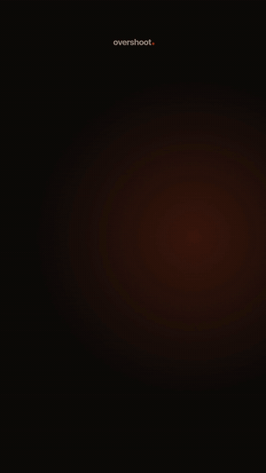
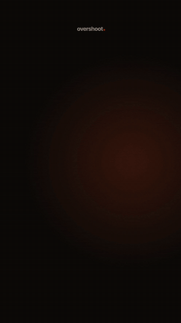
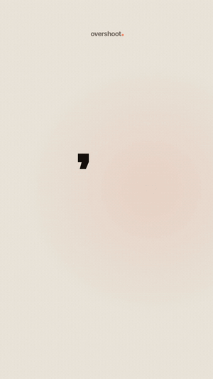
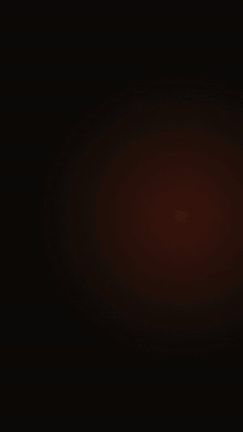

  

<h1 align="center">Overshoot</h1>

  <b>Motion graphics for your edits.</b> 
  Kinetic titles, counters, lower thirds and transitions that drop straight into your timeline.

  <a href="https://overshoot-motion.vercel.app"><b>Website</b></a> ·
  <a href="https://www.instagram.com/overshoot.motion/">Instagram</a> ·
  <a href="https://www.youtube.com/@overshootmotion">YouTube</a>

---

## The clips

| Hello | Stop scrolling | Odometer |
|:---:|:---:|:---:|
|  |  |  |
| The dot writes the word, overshoots, and floods the frame. | A feed that rips upward and stops dead on one line. | Every digit spins like an odometer and overshoots its number. |

Every clip comes in 9:16 for Shorts and Reels, with sound:

New clips go up on [Instagram](https://www.instagram.com/overshoot.motion/) and [YouTube](https://www.youtube.com/@overshootmotion) every day.

## Get the pack

- Every clip in 9:16 and 16:9
- Transparent versions (ProRes 4444) to lay over your footage
- The prompt behind each clip
- The editable source, so you can change the words and colours
- New clips added every week

👉 **[overshoot-motion.vercel.app](https://overshoot-motion.vercel.app)**

---

© 2026 Overshoot. All rights reserved. The clips, logo and brand assets in this repository may not be reused or redistributed.
